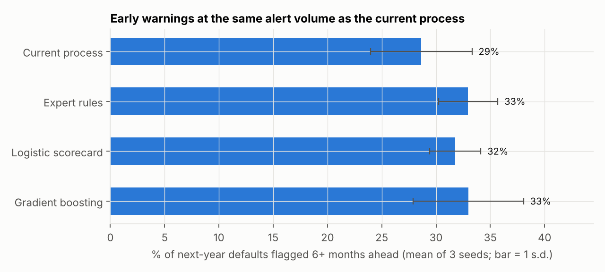
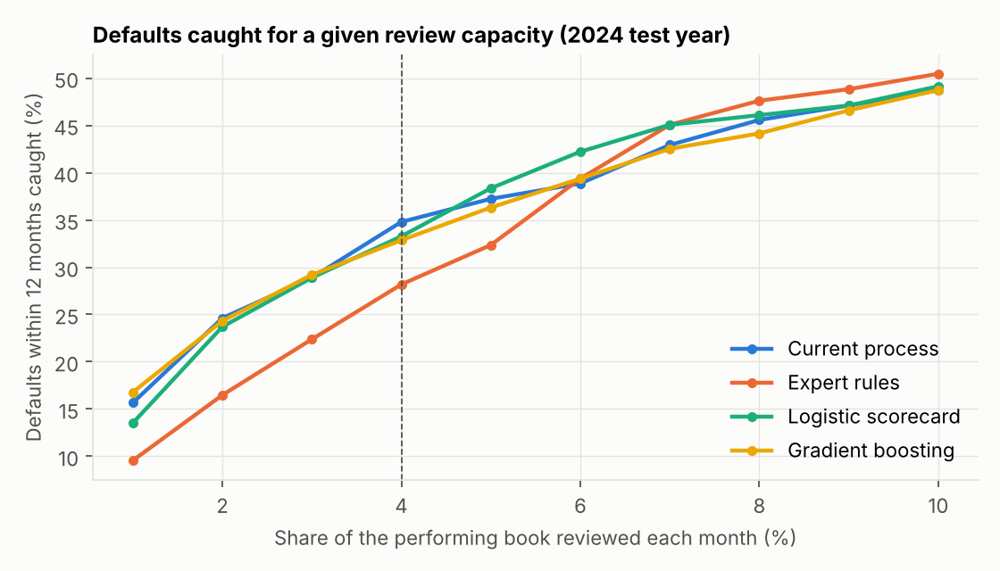
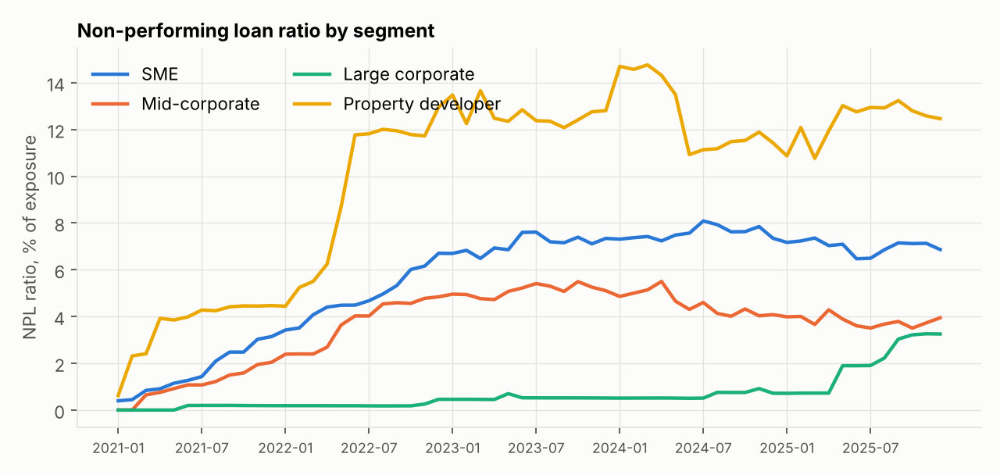
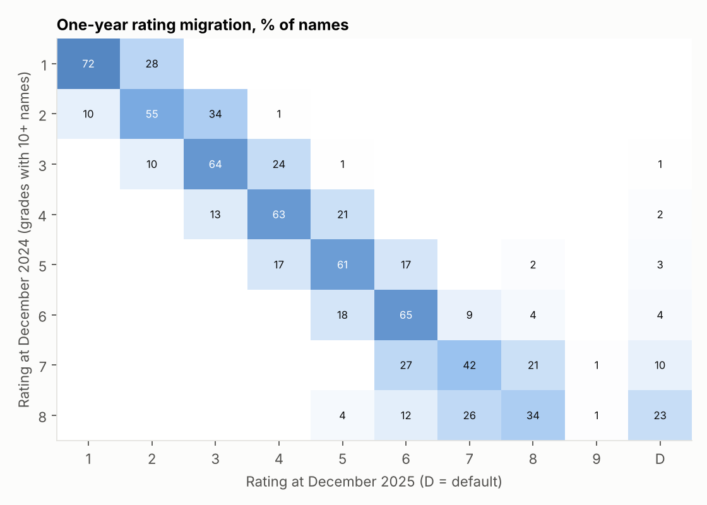

# Credit early-warning system

**Spotting corporate borrowers in trouble before the rating does: account-behaviour signals, interpretable scores and a portfolio-quality dashboard.**

> **Context.** I designed this early-warning indicator during my internship in the Counterparty Risk Surveillance department of a Moroccan bank (2026), as a proposal combining account behaviour with rating trends. It was not implemented at the bank. This repository builds it afterwards, end to end, on a **synthetic** corporate portfolio: no bank data, systems or internal documents are used.

---

## The problem

Corporate ratings are reviewed once a year, from audited statements that are already 6 to 18 months old. Many banks put names on watch only when the rating falls to its weakest grades or payments are 30+ days late, which is often a few months before default. Account behaviour moves earlier: overdrafts creep towards their limits, payments bounce and turnover through the account falls. The question is whether those signals give risk teams more time, for the same number of names to review.

## What it does

- **Synthetic portfolio** (`src/ews/generate.py`): 3,000 Moroccan corporate counterparties (SMEs, mid-corporates, large corporates, property developers), monthly from 2021 to 2025, with sector cycles (tourism 2021, drought 2022, construction and real estate 2023-2025), account behaviour, annual financials, annual rating reviews and defaults. How it works: [`docs/DATA_GENERATION.md`](docs/DATA_GENERATION.md).
- **Point-in-time features** (`features.py`): 17 behaviour, rating, financial and sector indicators, each built only from information available at that month.
- **Four early-warning scores** (`models.py`):
  - the current process (rating 8-9 or 30+ days past due);
  - expert trigger rules;
  - a logistic scorecard that gives the reasons behind every alert;
  - gradient boosting.
- **Out-of-time evaluation** (`evaluate.py`): trained on 2021-2022, tested on 2024. Models are compared at equal review capacity (4% of the book per month, about what the current process flags), with lead time before default, calibration and score stability (PSI), over 3 seeds.
- **Portfolio-quality views** (`portfolio.py`): exposure by rating bucket, NPL ratio by segment, cost of risk by sector and a one-year rating-migration matrix.
- **Monthly alert list:** the names to review, with their 12-month PD and the main reasons, separating names already on watch from new ones.

## Results

| Score | AUC | PR-AUC | Defaults flagged 6+ months ahead |
|---|---|---|---|
| Current process | 0.800 | 0.206 | 29% |
| Expert rules | 0.816 | 0.192 | 33% |
| Logistic scorecard | **0.822** | 0.216 | 32% |
| Gradient boosting | 0.812 | **0.272** | **33%** |

Means over 3 seeds; full tables in [`outputs/ews_report.md`](outputs/ews_report.md).

- **Earlier warnings at the same workload:** about a third of next-year defaults are flagged at least six months ahead, against 29% for the current process.
- **Better ranking of the riskiest names:** gradient boosting lifts PR-AUC from 0.21 to 0.27.
- **New names on the list:** in the latest month, 23 of the 104 alerted names are not on the current watch list.
- **The gains are modest,** and the seed-to-seed spread is wide. Ratings and arrears already carry much of the signal; account behaviour mainly adds timing.

<p align="center">
  
  
</p>
<p align="center">
  
  
</p>

## Quickstart

```bash
pip install -r requirements.txt
python scripts/run_all.py      # generates data/, trains, evaluates, writes outputs/ (about 30 s)
pytest                         # 6 tests: realism checks, point-in-time features, no train/test overlap
```

## Repository layout

```
src/ews/
  generate.py     synthetic portfolio (counterparties, monthly behaviour, financials, ratings, defaults)
  features.py     point-in-time features and the 12-month default target
  models.py       current process, expert rules, logistic scorecard (with alert reasons), gradient boosting
  evaluate.py     out-of-time split, AUC/KS/PR-AUC, capacity alerts, lead time, calibration, PSI
  portfolio.py    exposure mix, NPL ratio, rating migration, cost-of-risk proxy
  report.py       figures, alert list and the Markdown report
scripts/run_all.py
data/             the generated portfolio (seed 42)
outputs/          report, figures, metrics by seed, latest alert list
docs/             how the data is generated
```

## Limitations

- The data is synthetic. Behaviour, rating and default mechanics are modelled assumptions, so the results show the method, not the performance on a real bank's book.
- About 85 defaults per test year is a small sample.
- The cost-of-risk figure is an expected-loss proxy (PD by rating x LGD), not an IFRS 9 calculation. Staging and lifetime ECL are covered in the separate IFRS 9 reconciliation project.

## Author

**Ayoub Amekzaz** · B.Sc. (Hons) Data Science, Cyprus International University · ayoub1am@icloud.com

Copyright © 2026 Cyprus International University. MIT license (see `LICENSE`).
